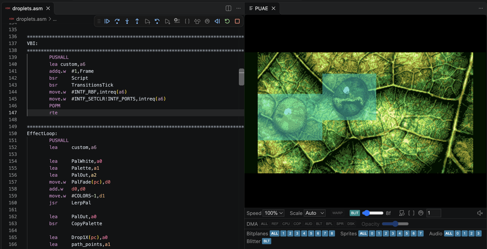
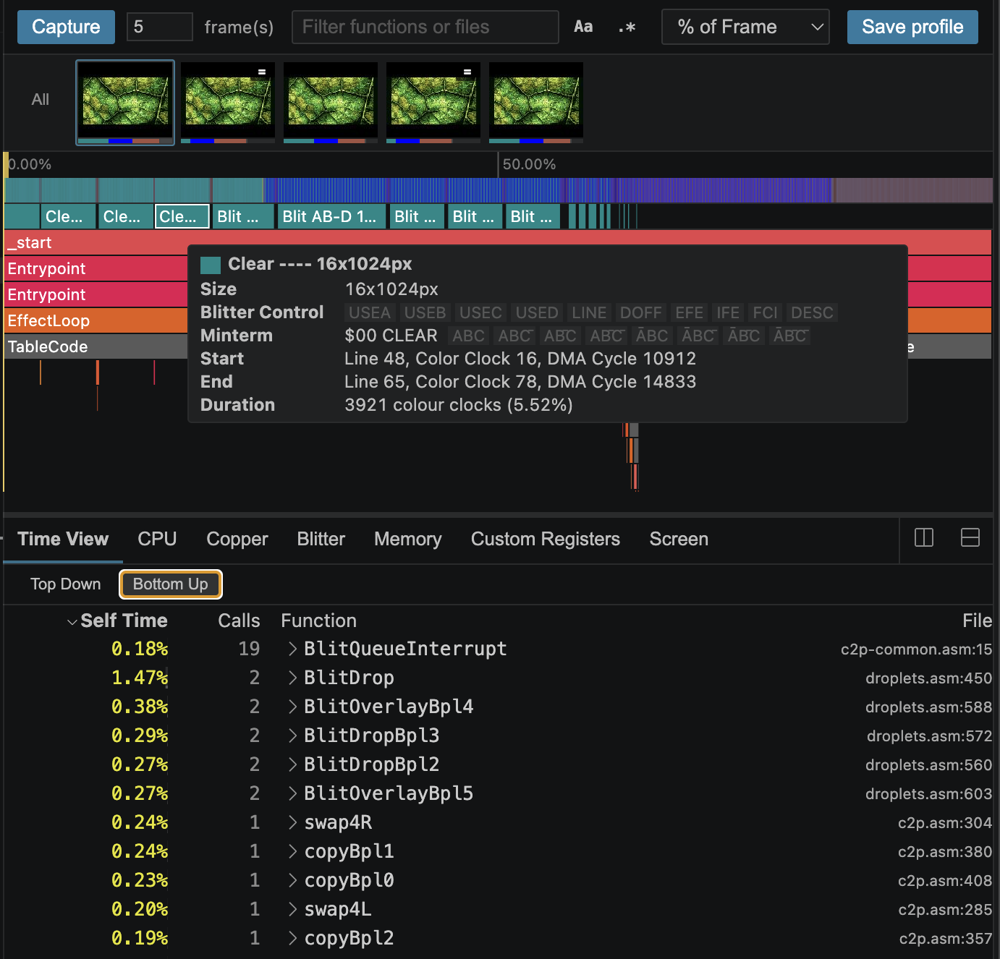
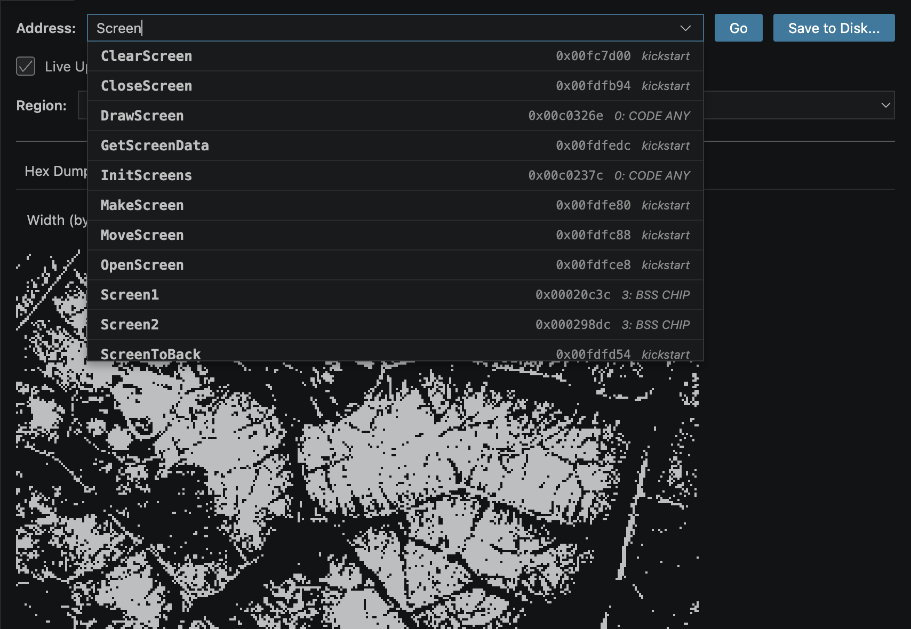
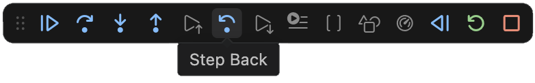

# PUAE Debugger

Debug and profile Amiga 68000 programs in VS Code with a [PUAE](https://github.com/libretro/libretro-uae) (WinUAE-derived) emulator running directly inside the editor as a webview — no external emulator process, no platform-specific binaries.

This overview focuses on the VS Code extension, but it's also available as a [standalone DAP-compatible debugger](docs/standalone.md) for any editor that supports the protocol, and as a headless emulator.

## Key features

Yet another Amiga debugger? Here's what's good about it:

### Embedded emulator

Running the emulator directly in the IDE avoids constant window switching, but more importantly gives us direct access to the running emulator state. It offers visual introspection tools like toggling DMA channels and blitter visualisation. Because the emulator core is based on WinUAE, it offers tried and tested compatibility for a wide range of hardware configs.



### Fast iteration

You can launch your program in milliseconds using the 'fast load' feature in the embedded emulator. This injects the program directly into RAM, and avoids emulating loading the executable from disk. Startup is close to instant.

### Advanced profiler

Thanks to Bartman for the initial port of the profiler tool from his [Amiga Debug extension](https://github.com/BartmanAbyss/vscode-amiga-debug), we now have full profiling capabilities. You can capture data for one or more frames, and see exactly where cycles are spent, plus a lot more. It's equally useful for debugging, as you can track register and memory state over time as you replay the profile. Profile data can also be exported in a machine-readable format.



### Memory viewer

Inspired by [Coppenheimer](https://coppenheimer.heckmeck.de/), you can inspect memory in a visual mode, as well as the usual hex view, and disassembly into CPU or Copper instructions.



### Reverse debugging



Great Scott! The debugger can step backwards as well as forwards, allowing you to travel back in time to what happened before a breakpoint was hit.

### Build agnostic

The debugger supports both Hunk and ELF executables, with symbols in DWARF, GCC stabs or LINE debug (vasm, SAS/C) formats. It provides line-based debugging for both assembly and C/C++ projects. As long as you can generate an executable with debug symbols in one of these formats, your build process is entirely up to you.

For C/C++, DWARF gets you the most: `.debug_frame`-based stack unwinding (used by the debugger's call stack and the profiler's unwind table) and inline function expansion (`DW_TAG_inlined_subroutine`), giving proper innermost-first inline call chains.

### Works alongside other extensions

You don't need to choose just one debugger extension. This one runs just fine alongside prb28 and Bartman's extensions. You can just add another launch config to your existing project.

### Automation API

The emulator and debugger can also be driven headlessly, and can be used for automated testing or LLM development if you're so inclined. This gives access to all the debugger features: stepping through code, inspecting machine state, and saving screenshots and profile data. There's a [JavaScript API](docs/javascript-api.md) and [MCP server](docs/commands.md) provided.

## Getting started

Once you've installed the extension from the VS Code Marketplace, you just need to add a launch config to your project. If you go to 'Run and Debug -> Add Configuration...' you can pick one of the PUAE presets, then edit the paths to your executable and Kickstart ROM. You can also edit `.vscode/launch.json` manually (see the [configuration reference](docs/configuration.md)). Here's an example config:

```json
{
	"type": "puae",
	"request": "launch",
	"name": "PUAE: A500 OCS 512k + 512k Slow",
	"program": "${workspaceFolder}/out/a.exe",
	"fastLoad": true,
	"stopOnEntry": false,
	"kickstartRom": "${workspaceFolder}/roms/kick13.rom",
	"emulatorOptions": {
		"cpu_model": 68000,
		"chipmem_size": 1,
		"bogomem_size": 2,
		"chipset": "ocs"
	},
	"preLaunchTask": "Build"
}
```

Once this is in place, just hit 'Start Debugging' (F5) to start your program. Maybe start by setting some breakpoints or capturing a profile.

Note that this extension is *only* a debugger/profiler, and not a full stack Amiga development solution. You need to bring your own build task to generate your Amiga executable. I'd suggest using a simple shell script or Makefile and wrapping it in a VS Code task in `.vscode/tasks.json`. Set that task as the `preLaunchTask` in your launch config (as above) to ensure your project is rebuilt on launch.

You'll probably also want a language extension to give you syntax highlighting etc. for assembly. If you already have prb28's extension installed you can use the one bundled with it, or you might want to check out my own [m68k-lsp extension](https://marketplace.visualstudio.com/items?itemName=gigabates.m68k-lsp), which has a load of useful features. While I'm plugging my other 68000-related extensions, you might want to check out [68k counter](https://marketplace.visualstudio.com/items?itemName=gigabates.68kcounter) and [m68k-lint](https://marketplace.visualstudio.com/items?itemName=gigabates.m68k-lint-vscode).

## License

This project is licensed under the [GNU General Public License version 2](LICENSE.txt). See [THIRD_PARTY_NOTICES.md](THIRD_PARTY_NOTICES.md) for attribution, component licensing, and source provenance.

Emulation is powered by [PUAE](https://github.com/libretro/libretro-uae) (libretro-uae), derived from WinUAE by Toni Wilen and contributors.